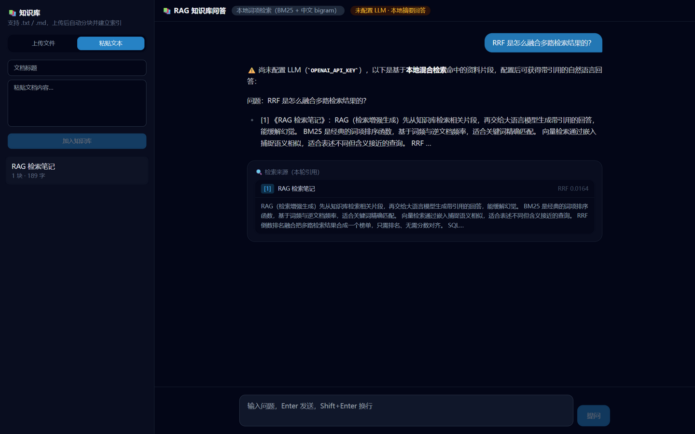

# 📚 RAG 知识库问答

一个从零实现的 RAG（检索增强生成）应用：文档上传 → 分块 → 混合检索（BM25 + 向量 + RRF 融合）→ 带引用的流式回答。**不配置任何 API Key 也能完整运行**（本地词项检索 + 摘要式回答），配置后自动升级为向量混合检索与 LLM 引用式回答。



> 与 [Agent Workbench](https://github.com/rwzdk/agent-workbench)（工具调用型 Agent）互补：那个项目讲全栈工程广度（认证/CRUD/流式/工具编排），本项目讲 **检索与 RAG 的深度**（分块策略、混合检索、排序融合、检索质量评估）。两者组成"AI 应用开发"的完整作品集。

## 功能

- 📄 **知识库管理**：上传 `.txt` / `.md` 或直接粘贴文本，自动分块入库、删除重建
- ✂️ **分块策略**：优先沿段落边界聚合，超长段落硬切并保留 overlap 上下文（参数可调，见 `src/lib/chunker.ts`）
- 🔍 **混合检索**：
  - BM25 词项检索（Lucene 风格 IDF，中文无需词典的 bigram 分词，纯函数实现）
  - 可选向量检索（任意 OpenAI 兼容 embedding 接口，余弦相似度）
  - 两路结果用 **RRF（Reciprocal Rank Fusion）** 融合——只依赖排名不依赖分数，天然规避两路分数量纲不可比的问题
- 💬 **引用式回答**：回答强制基于检索片段并标注 `[n]`，来源以引用卡片展示（含 RRF 分数），模型被告知"资料不足要明说"
- 📉 **优雅降级**：无 LLM Key → 本地摘要回答；无 embedding Key → 纯 BM25；全程不崩
- 📊 **检索质量评估**：`npm run eval` 在标注语料上计算 hit@3 与 MRR，作为 CI 门禁（改分块/检索参数跑一下就知道有没有退步）
- 🧪 26+ 单元测试（分块器 / 分词 / BM25 / 余弦 / RRF / 评估）+ GitHub Actions CI

## 技术栈

| 层 | 选型 |
| --- | --- |
| 前端 | Next.js 14 (App Router) · React 18 · TypeScript · Tailwind CSS |
| LLM / 嵌入 | Vercel AI SDK v4（`streamText` / `embedMany` / 自定义数据分片下发来源） |
| 检索 | 自研：BM25 + bigram 中文分词 + 余弦相似度 + RRF 融合（零外部检索依赖） |
| 数据库 | SQLite（libSQL client；向量以 JSON 存储，纯 JS 计算余弦，规模大可平滑迁移 sqlite-vec / Turso Vector） |
| 质量 | Vitest · `tsc --noEmit` · GitHub Actions CI |

## 快速开始

```bash
npm install
npm run dev          # 无需任何 Key 即可体验本地检索
```

打开 http://localhost:3000 ，左侧粘贴一段文本加入知识库，直接提问。

可选配置（复制 `.env.example` 为 `.env`）：

| 变量 | 作用 |
| --- | --- |
| `OPENAI_API_KEY` | 接入 LLM 生成引用式回答（兼容 DeepSeek 等，配 `OPENAI_BASE_URL` / `OPENAI_MODEL`） |
| `EMBEDDINGS_API_KEY` + `EMBEDDINGS_MODEL` | 接入 embedding 接口，升级为混合检索（配 `EMBEDDINGS_BASE_URL` / `EMBEDDINGS_DIMENSION`） |
| `LIBSQL_URL` | 远程 libSQL/Turso；不填用本地 `data/app.db` |

## 架构

```
入库：文档 → chunkText（段落聚合 + 硬切 overlap）→ [可选] embedMany → chunks 表
提问：question
  ├─ 路1：tokenize（拉丁词 + 中文 bigram）→ BM25 排序
  ├─ 路2：[可选] 查询嵌入 → 与分块余弦相似度排序
  └─ rrfFuse(两路榜单, k=60) → topK 来源
       → writer.writeData({sources})          # 引用卡片随流下发
       → streamText(参考资料 + 问题)           # 流式引用式回答
```

```
src/
├── app/
│   ├── page.tsx                    # 单页应用
│   └── api/
│       ├── documents/...           # 文档列表 / 入库（分块+嵌入）/ 删除
│       ├── ask/route.ts            # 核心：混合检索 + RRF + 数据流响应
│       └── config/route.ts         # 前端能力徽章（llm / embeddings 是否可用）
├── components/                     # KnowledgeApp / DocumentsPanel / SourceCard
├── lib/
│   ├── chunker.ts                  # 分块（可测试的纯函数）
│   ├── tokenize.ts                 # 拉丁词 + 中文 bigram 分词
│   ├── bm25.ts                     # BM25 排序函数（Lucene IDF）
│   ├── retriever.ts                # 余弦相似度 + RRF 融合
│   ├── embeddings.ts               # 嵌入层（含降级逻辑）
│   ├── rag.ts                      # 提示词 / 引用上下文 / 本地降级回答
│   └── db.ts                       # libSQL 客户端 + 建表
└── tests/                          # 单元测试 + 检索评估（hit@3 / MRR）
```

### 为什么自己实现检索而不是调库？

语料量在千级分块以下时，纯 JS 的 BM25 + 暴力余弦足够快（毫秒级），换来三个收益：每个环节可单元测试、行为可解释（面试能讲清每一层）、无外部服务依赖（零 Key 可跑）。README 的 Roadmap 里给出了向量化检索（sqlite-vec）的升级路径——什么时候换、为什么换，比"上来就用向量库"更有说服力。

## 检索质量评估

```bash
npm run eval
```

在 6 篇中文标注语料 × 6 个问题上运行本地检索，输出每题命中情况并断言 **hit@3 ≥ 0.83、MRR ≥ 0.78**。调整分块参数或 BM25 的 k1/b 后跑一遍，指标退化就会挡在 CI——这是"改了参数心里有底"的依据。

## 简历可以这样写（示例）

- 从零实现 RAG 知识库问答系统：文档分块（段落聚合 + overlap）、BM25 + 向量混合检索、RRF 排序融合、带引用溯源的流式回答，检索与生成全链路零外部服务依赖、可离线运行
- 无词典场景下实现中文 bigram 分词与 Lucene 风格 IDF 的 BM25（纯函数实现），并通过 RRF 与向量检索融合，兼顾关键词精确匹配与语义召回
- 建立检索质量评估基线（hit@3 / MRR 标注集），纳入 CI 门禁，使分块与检索参数调整可量化验证
- 基于 AI SDK 数据流协议自定义数据分片，将检索来源随回答流式下发，前端实时渲染引用卡片

## Roadmap

- [ ] PDF / Word 解析入库
- [ ] sqlite-vec 向量索引（分块规模上万时的升级路径）
- [ ] 检索后 rerank（交叉编码器或 LLM rerank）
- [ ] 多轮对话的查询改写（query rewrite）
- [ ] 评估页面化：可视化 hit@k / MRR 曲线

## License

MIT
